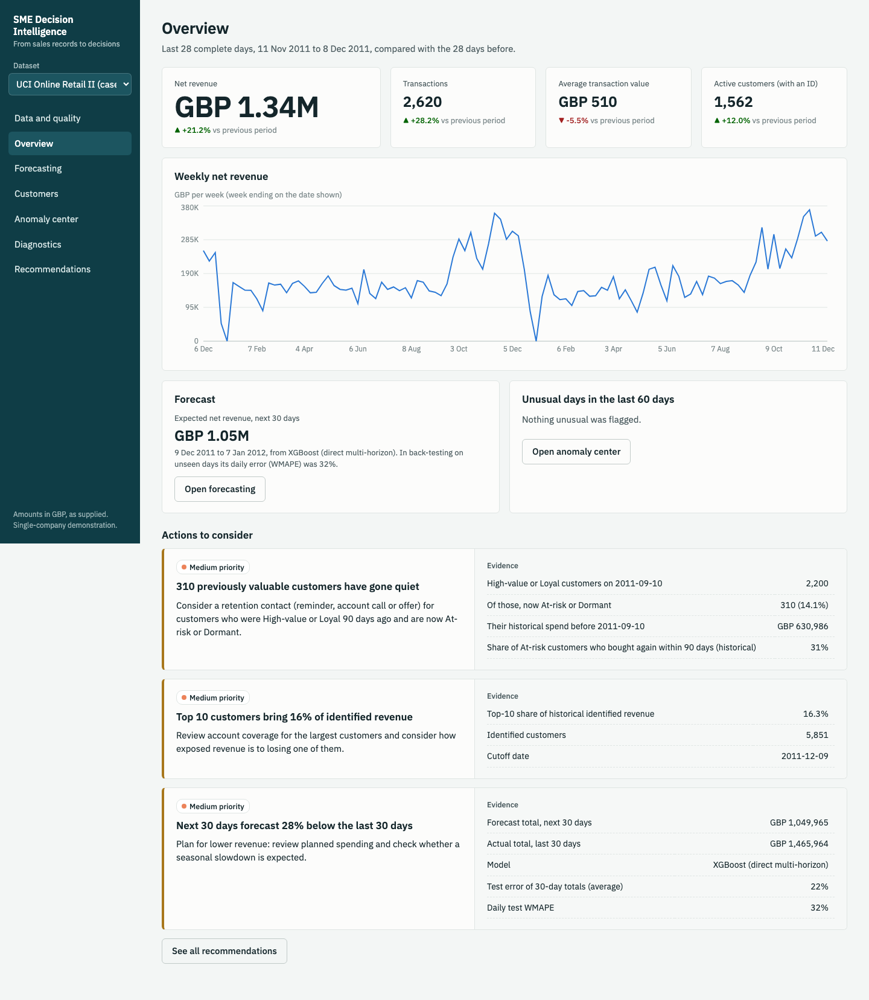

# GCC SME Decision Intelligence

Upload a company's transaction data and get KPIs, forecasts, customer segments, anomaly alerts,
revenue diagnostics and evidence-backed recommendations in one dashboard.

The intended users are small and medium-sized companies in the GCC. The development case study
is a public UK retail dataset in GBP; it is an example, not evidence about GCC companies.
Status: working MVP, tested locally. **Not deployed** (see `docs/deployment.md`).



## What it does

| Page | What you get | Method |
|---|---|---|
| Data and quality | CSV upload, column mapping, every removed row counted, calendar check, list of supported modules with reasons | Canonical schema, capability registry |
| Overview | Net revenue, transactions, average value, active customers against the previous period | One KPI module used by every page |
| Forecasting | 7- and 30-day daily revenue forecasts with error ranges, model comparison and back-test | Seasonal naive, SARIMA, XGBoost; rolling-origin validation; untouched test window |
| Customers | RFM segments, a check of what each segment did next, K-Means comparison | Rule-based RFM, K-Means with silhouette and bootstrap stability |
| Anomaly center | Ranked unusual days with expected range and evidence | Same-weekday robust z-score; Isolation Forest as second opinion |
| Diagnostics | A revenue change split into parts that add up to it | Shapley decomposition; contributions by product, location, segment, weekday |
| Recommendations | Actions to consider, each with the numbers that triggered it | Transparent rules; no language model |

Unsupported features say why instead of showing made-up numbers. On the case study the 90-day
forecast is switched off because it failed its test check.

## Results on the case study (details in `docs/technical_report.md`)

- 1,067,371 rows in, 1,021,254 kept; every removal is counted and explained.
- Forecast WMAPE on unseen test days: 28 to 38% at 7 days and 31 to 35% at 30 days depending on
  the model. Fitted models beat the naive baseline on validation, but the model picked on
  validation was not the best on test at any horizon.
- 80% forecast ranges covered 83% of test days at 7 and 30 days.
- High-value customers repurchased within 90 days 80% of the time; Dormant customers 12%.
- The anomaly detector finds very large shocks (68% of injected 70% drops) and misses moderate ones.

## Run it locally

Requirements: Python 3.11+, Node 20+, PostgreSQL 14+ (SQLite works for a quick look).

```
gunzip -k data/raw/online_retail_II.csv.gz                 # case-study data (CC BY 4.0, see docs/dataset.md)
pip install -r backend/requirements-dev.txt
(cd frontend && npm ci && npm run build)

createuser smedi --pwprompt && createdb smedi --owner smedi   # password: smedi_local, or set DATABASE_URL
scripts/run_local.sh                                          # API + dashboard on http://localhost:8000
```

Open the dashboard and choose "Load the public case study" (about half a minute), or upload your
own CSV. For frontend development run `npm run dev` in `frontend/` (port 5173, proxies `/api`).

Without PostgreSQL: `DATABASE_URL=sqlite:///./local.db scripts/run_local.sh`.

## Commands

| Task | Command |
|---|---|
| Tests (26) | `cd backend && python -m pytest` |
| Browser test of upload to dashboard | `python scripts/e2e_upload.py` (server running) |
| Screenshots | `python scripts/screenshots.py` (server running, case study loaded) |
| Forecast experiment | `python backend/experiments/run_forecast_experiments.py` |
| Segmentation experiment | `python backend/experiments/run_segmentation.py` |
| Anomaly evaluation | `python backend/experiments/run_anomaly_eval.py` |
| Docker | `cp .env.example .env && docker compose up -d --build` (not yet built by the author) |

## Layout

```
backend/app/core        schema and mapping, cleaning, daily table with day status, KPIs, capabilities
backend/app/ml          forecasting, customer segments, anomaly detection
backend/app/analytics   diagnostics, recommendation rules
backend/app/api         FastAPI routes, database models, background job service
backend/app/pipeline.py one dataset from raw file to saved outputs
backend/experiments     reproducible experiments that write to results/
backend/tests           unit and API tests (synthetic fixtures)
frontend/src            React dashboard
configs/                column mapping for the case study
results/                experiment outputs quoted in the report
deploy/aws, Dockerfile, docker-compose.yml   deployment configuration
docs/                   technical report, dataset provenance, deployment, 30-day plan, CV bullets, screenshots
```

## Data contract

One row is one line item of a transaction (a transaction-level file is the case of one line per
transaction). Required: a timestamp and a value (amount, or quantity and unit price). Optional
fields unlock more: transaction ID, customer ID, product, category, location, channel. The
currency is entered by the user and never converted. Details: `backend/app/core/schema.py` and
`backend/app/core/ingest.py`.

## Security and privacy

Single-company demonstration with datasets separated by ID. Optional API key for every endpoint.
Upload size limit, CSV-only uploads, validated mapping, secrets from environment variables only.
Customer IDs stay on the server; the API returns aggregates. Deleting a dataset removes its files
and database rows.

## Limitations

- Evaluated on one dataset from one UK retailer. No claim is made about other industries or the GCC.
- No holiday, promotion, price or stock data. Moving holidays such as Ramadan and Eid are not modelled.
- Segments are descriptive rules, not churn probabilities; spend is historical, not predicted lifetime value.
- Recommendations are suggestions from fixed rules and have not been tested with users.
- One worker process; a server restart fails a running job.
- Docker and AWS configuration are written but have not been run.

## Roadmap (deferred, not built)

Holiday calendars including Hijri dates; supervised churn; predicted lifetime value; stock-out
prediction when inventory and lead-time fields exist; a bounded "Ask Your Business" interface;
multi-company accounts; Alembic migrations; a second industry case study.

## Licence and attribution

Code: MIT (`LICENSE`). Data: Online Retail II by Daqing Chen, UCI Machine Learning Repository,
CC BY 4.0, https://doi.org/10.24432/C5CG6D.
